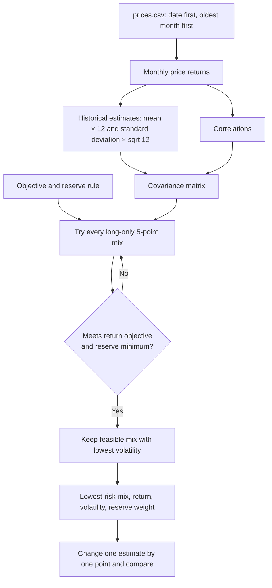

# Lab 15 — Portfolio Stability Decision

**Student:** Kara Braccio  
**App:** [app.py](app.py)  
**Engine:** [portfolio.py](portfolio.py)

## Decision rule

The app selects the long-only mix with the lowest portfolio volatility that meets both the expected-return objective and the reserve-eligible minimum. It calculates portfolio volatility as `sqrt(w' covariance w)`, so every covariance term is included. The input controls let the client change the expected-return objective, reserve rule, and each sleeve's expected-return estimate.

## Run the app

Use the virtual environment that has Streamlit installed:

```powershell
.\.venv\Scripts\Activate.ps1
python -m streamlit run app.py
```

Streamlit is installed in this workspace's `.venv`. If it is missing in a different environment, install it there with:

```powershell
python -m pip install streamlit
```

## Meridian inputs

The default Meridian view imports its course-authored expected returns, volatilities, correlations, 6.5% objective, and reserve-eligible Treasury definitions from `portfolio.py`. The app uses Meridian's 3.0% reserve minimum from Lab 13.

## Portfolio engine flowchart



## Project 2 universe

The **Project 2 ETF history** choice reads `prices.csv` and uses BIL and IEF as reserve-eligible sleeves. It estimates annualized arithmetic mean returns and covariance from the 59 complete monthly returns (November 2021–September 2026). Those historical estimates describe the sample; they are not forecasts. The objective and reserve controls must be set to the student's own Project 2 mandate before making that client decision.

### Project 2 client mandate

**Client:** A community arts nonprofit investing a reserve fund with a five-year horizon.

**Objective:** Earn an expected annual return of at least **5.5%** to support future programming while preserving purchasing power.

**Hard constraint:** At least **20%** of the portfolio must be in reserve-eligible, highly liquid BIL and IEF holdings. After uploading `prices.csv`, set the app's objective to 5.5%, reserve minimum to 20.0%, and tick BIL and IEF before running the Project 2 decision.

### Project 2 decision and stability result

Using the 5.5% objective and 20.0% reserve rule, the app's 5-point-search, lowest-volatility feasible historical-estimate mix is **75% BIL, 0% IEF, 0% LQD, and 25% VT**. It has a 5.51% expected return, 3.84% volatility, and a 75.0% reserve-eligible weight.

For the one-point attack, I decreased VT's expected return by 1.0 percentage point. The mix changed to **70% BIL and 30% VT**; its volatility rose to 4.58% and its reserve-eligible weight fell to 70.0%. The mandate remains feasible, but the 5-point allocation shift and higher volatility show that the recommendation is estimate-sensitive. This is a classroom result using historical estimates, not an investment recommendation.

### Required app results: 5-point search

For these app runs, I uploaded `prices.csv`, set the objective to 5.5%, set the reserve minimum to 20.0%, and ticked BIL and IEF as reserve-eligible assets. The app's estimates are historical estimates, not forecasts.

| Price window | Lowest-risk mix: BIL / IEF / LQD / VT | Expected return | Volatility | Reserve eligible |
|---|---:|---:|---:|---:|
| All 59 monthly returns | 75% / 0% / 0% / 25% | 5.51% | 3.84% | 75.0% |
| Last 36 monthly returns | 90% / 0% / 0% / 10% | 5.95% | 1.21% | 90.0% |

The largest allocation change between the all-month and last-36-month answers is **15 points**: BIL rises from 75% to 90% and VT falls from 25% to 10%.

### Partner attack

My partner challenged the VT expected-return estimate, so I lowered it by one percentage point using all-month inputs. The answer changed from 75% BIL / 25% VT to 70% BIL / 30% VT, and volatility rose from 3.84% to 4.58%; the mix remains feasible but is sensitive to the VT estimate.

### My call

**Pilot, not adopt:** the app gives a feasible low-volatility starting allocation, but changing the historical window moves 15 percentage points between BIL and VT. I would reconsider the allocation once the client approves a forward-looking return-estimate method and the appropriate history window, rather than treating a five-year average as a forecast.

## One-point attack

Choose one sleeve under **One-point stability test**, decrease or increase its expected return by 1.0 percentage point, and compare the base and changed allocations. A material allocation change—or an infeasible revised problem—means the recommendation is not stable under that estimate change.

## Explain to a partner

The optimization chooses the smallest volatility only among portfolios that first meet the client's target return and reserve constraint. The 1-point test matters because the selected mix can depend on uncertain return estimates; the app makes that dependency visible rather than treating the output as certain.
